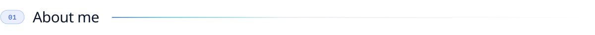
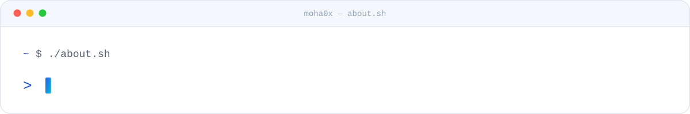
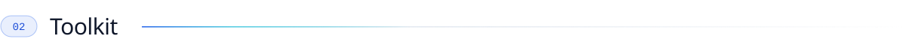
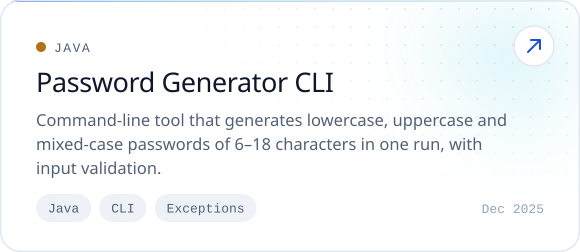
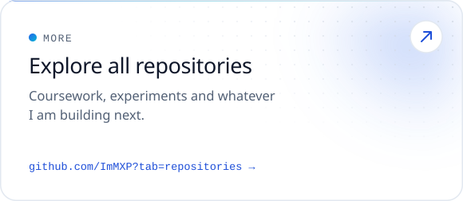

<picture>
  <source media="(prefers-color-scheme: dark)" srcset="assets/banner-dark.svg">
  
</picture>

 

<picture>
  <source media="(prefers-color-scheme: dark)" srcset="assets/headers/about-dark.svg">
  
</picture>

<picture>
  <source media="(prefers-color-scheme: dark)" srcset="assets/about-console-dark.svg">
  
</picture>

<picture>
  <source media="(prefers-color-scheme: dark)" srcset="assets/headers/toolkit-dark.svg">
  
</picture>

  <b>DAILY DRIVERS</b>  
  <picture>
    <source media="(prefers-color-scheme: dark)" srcset="https://skillicons.dev/icons?i=java%2Cpython%2Clinux%2Cgit%2Cgithub&theme=dark">
    
  </picture>

  <b>EXPLORING</b>  
  <picture>
    <source media="(prefers-color-scheme: dark)" srcset="https://skillicons.dev/icons?i=flutter%2Cdart%2Chtml%2Ccss%2Cjs&theme=dark">
    
  </picture>

<picture>
  <source media="(prefers-color-scheme: dark)" srcset="assets/headers/projects-dark.svg">
  
</picture>

  <a href="https://github.com/ImMXP/employee-management-system"><picture><source media="(prefers-color-scheme: dark)" srcset="assets/projects/employee-management-system-dark.svg"></picture></a>
  <a href="https://github.com/ImMXP/password-generator-cli"><picture><source media="(prefers-color-scheme: dark)" srcset="assets/projects/password-generator-cli-dark.svg"></picture></a>
  <a href="https://github.com/ImMXP/quran-telegram-bot"><picture><source media="(prefers-color-scheme: dark)" srcset="assets/projects/quran-telegram-bot-dark.svg"></picture></a>
  <a href="https://github.com/ImMXP?tab=repositories"><picture><source media="(prefers-color-scheme: dark)" srcset="assets/projects/all-repositories-dark.svg"></picture></a>

<picture>
  <source media="(prefers-color-scheme: dark)" srcset="assets/headers/activity-dark.svg">
  
</picture>

<picture>
  <source media="(prefers-color-scheme: dark)" srcset="https://raw.githubusercontent.com/ImMXP/ImMXP/output/stats-dark.svg">
  
</picture>

<picture>
  <source media="(prefers-color-scheme: dark)" srcset="https://raw.githubusercontent.com/ImMXP/ImMXP/output/snake-dark.svg">
  
</picture>

<picture>
  <source media="(prefers-color-scheme: dark)" srcset="assets/footer-dark.svg">
  
</picture>

